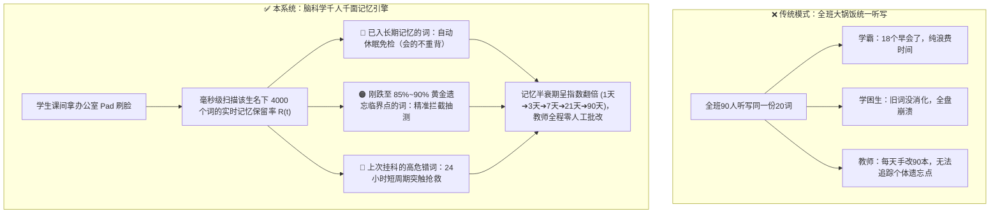

# 同济大学附属中学 — 办公室 AI 智能背词助教系统
# 功能性需求规格说明书（V3.1：脑科学千人千面记忆引擎 + 三阶自适应题型界面 + 模拟 Pad/教师端分离）

> **版本状态**：V3.1（新增“三阶自适应题型界面”设计，彻底解决同义词撞车、区分认知词与产出词、实现音形义语境合一）  
> **工程目录**：`D:\同济附中背词助教终端`  
> **核心理念**：**会的不重背、忘的卡点拦、一人一曲线、考法自适应、教师零批改**

---

## 第一章：项目终极价值主张 —— 为什么必须终结“全班统一听写”？

### 1.1 传统高中英语“全班大锅饭听写”的三大痛点
在高中英语日常教学中，“全班统一报听写 / 默写同一张词表”是延续了几十年的惯性做法，但从认知科学与教学效率来看，它存在三大不可调和的矛盾：

1. **人类教师的生理记忆极限（36 万个动态记忆节点无法靠人脑追踪）**：
   - 一名高中英语教师通常执教 2 个班级（约 90~100 名学生），面对上海高考 4000~5500 个核心与拓展词汇。
   - 全班总计存在 **$90 \text{ 人} \times 4000 \text{ 词} = 360,000 \text{ 个独立的“学生-单词”记忆节点}$**。
   - 每个学生对每个单词的遗忘速率截然不同：张晓明对 `sustainable` 背一次能记 30 天，但对 `harbor（心怀）` 3 天就忘；李佳琪对 `phenomenon` 连续错了三次，今天正处于遗忘崩溃边缘。**没有任何一位人类教师能记住 90 个孩子各自哪天该复习哪几个词**，最终只能妥协为“全班统一听写第 3 单元 20 个词”。
2. **对学生的双重低效内耗（学霸无效陪跑，学困生认知超载）**：
   - **优等生**：全班听写 20 个词，其中 18 个早已进入他的长期记忆区，反复默写纯属机械陪跑（零记忆增益），而真正卡住他冲刺 135+ 的熟词僻义和派生词却根本没测到；
   - **基础薄弱生**：前三天漏掉的基础核心词还没形成稳定突触，又被强行灌入新单元难词，听写本上一片红叉，陷入“背了忘、忘了抄、抄了再忘”的习得性无助。
3. **对教师的纯体力透支**：
   - 教师每天耗费 1 ~ 1.5 小时在“课堂报听写 $\rightarrow$ 收齐 90 本默写本 $\rightarrow$ 逐本手工打勾画叉 $\rightarrow$ 统计未过关名单 $\rightarrow$ 课间盯着学生重默”的机械劳动上，挤占了宝贵的备课与教研精力。

---

### 1.2 本系统的终极价值：全天候在线的“私人脑科学记忆精算师”

- **对学生（背词效率提升 3 倍以上）**：彻底告别“陪跑式默写”。系统实时计算每个词在该生大脑中的遗忘曲线，**只在他“快要忘但还没全忘”的那一刻精准抽测**，用最少的时间把单词送入永久记忆。
- **对教师（100% 剥离机械监背与批改）**：机器替老师精准托管全班 36 万个记忆节点，自动完成出题、语音/拼写评测、动态排期与待补测预警。

---

## 第二章：核心脑科学记忆算法规范（Ebbinghaus × FSRS 间隔重复模型）

本系统后台不采用粗暴的“随机抽题”或“固定顺序抽题”，而是为**每一个（学生 $i$, 单词 $j$）组合**独立维护一套符合现代认知神经科学的动态记忆参数。

### 2.1 三大脑科学理论支柱
1. **艾宾浩斯指数遗忘模型（Ebbinghaus Forgetting Curve）**：
   任意时刻 $t$（距上次成功提取经过的天数），学生对该单词的**实时记忆保留率（Retrievability, $R$）**遵循衰减方程：
   $$R(t) = 0.9^{\frac{t}{S}}$$
   其中 $S$ 为该学生对该单词当前的**记忆稳定性（Memory Stability / 记忆半衰期，单位：天）**，代表记忆保留率从 $100\%$ 自然衰减到 $90\%$ 所需的天数。
2. **比约克“必要难度”与黄金提取窗口（Bjork's Desirable Difficulty）**：
   - 当 $R > 92\%$ 时复习：记忆过于鲜活，提取毫不费力，大脑海马体不触发深度重编码，属于**无效重复**；
   - 当 $R < 70\%$ 时复习：记忆痕迹已严重消退，形同重新背诵，挫败感强；
   - **黄金提取窗口（$82\% \le R \le 90\%$）**：在即将遗忘的临界点进行一次主动回忆提取（Active Recall），突触强化效应最强！一旦提取成功，新的记忆稳定性 $S_{\text{new}}$ 将按指数倍增：
     $$S_{\text{new}} = S_{\text{old}} \times \left(1 + \alpha \cdot (11 - D) \cdot S_{\text{old}}^{-\beta}\right)$$
     典型演化路径：**`0.5天 (12小时)` $\rightarrow$ `1.5天` $\rightarrow$ `4天` $\rightarrow$ `10天` $\rightarrow$ `25天` $\rightarrow$ `60天（进入长期稳固记忆）`**。
3. **个体-单词耦合难度系数（Personal Item Difficulty, $D \in [1.0, 10.0]$）**：
   同一个单词对不同学生的难度不同。系统根据某生在该词上的历史得分、反应耗时与拼错次数，动态修正该生对该词的专属难度 $D$：$D$ 越高，复习间隔增长越谨慎；$D$ 越低，复习间隔拉长越快。

---

### 2.2 脑科学四态记忆分区（Memory Zones）
系统根据每个词当前的记忆稳定性 $S$ 与实时保留率 $R(t)$，将学生词库实时划分为四个动态脑科学区间：

| 脑科学记忆分区 | 状态标识 (`zone`) | 触发条件与脑科学含义 | 系统调度策略 |
| :--- | :--- | :--- | :--- |
| **🔴 瞬时突触抢救区** | `critical_rescue` | 上次测试未达标（`< 合格线`）或连续拼错，$S \le 1.0\text{天}$，记忆痕迹受损 | **最高优先级（第 1 顺位抽测）**：锁定在 12~24 小时短周期内强制复现，并提示上次具体错因，须连续 2 次精准提取方可解除抢救状态。 |
| **🟠 黄金遗忘临界区** | `golden_review` | $S > 1.0\text{天}$，且今日实时记忆保留率 **$R(t)$ 刚好跌入 $80\% \sim 90\%$ 临界窗口** | **核心拦截区（第 2 顺位抽测）**：此时复习 1 次等于平时盲目抄写 10 次！按 $R(t)$ 从低到高排序，精准卡点强化。 |
| **🔵 长期记忆休眠区** | `consolidated_sleep` | 实时保留率 $R(t) > 90\%$（距离下次遗忘临界点尚远）或 $S \ge 30\text{天}$ | **自动免检冻结（严禁抽测）**：大脑皮层突触已稳固，系统自动跳过，绝不浪费学生时间，直至未来某天 $R(t)$ 自然衰减至 $90\%$ 时再自动唤醒。 |
| **⚪ 待激活新词区** | `unactivated_new` | 尚未建立初次记忆痕迹的新词（按上海高考 L1~L5 分级） | **弹性补充区（第 3 顺位抽测）**：仅当今日“🔴抢救区 + 🟠黄金临界区”词数少于单次认知负荷上限（默认 8 词）时，按学生当前能力层级适量注入新词。 |

---

### 2.3 刷脸瞬间的“千人千面”组卷流程
当学生拿起办公室 Pad 完成刷脸的 0.1 秒内，后台确定性算法执行以下调度：
1. **实时重算全库记忆保留率**：根据当前系统时间与该生每个词的 `last_review_at` 和 `stability`，算出所有已学词此刻的 $R(t)$；
2. **生成今日专属黄金词单（默认 6~8 词，符合工作记忆容量 $7 \pm 2$ 铁律）**：
   - 先取 **🔴 瞬时突触抢救区** 词汇；
   - 再取 **🟠 黄金遗忘临界区** 到期词汇；
   - 余下名额从匹配该生目标分数段（L1~L5）的 **⚪ 待激活新词区** 抽取；
3. **计算“脑科学减负感知指标”**：
   - 自动统计该生名下处于 **🔵 长期记忆休眠区** 的单词总数，在 Pad 首页显式告知学生：  
     *“🧠 脑科学引擎已为您自动过滤 **128 个**处于稳固记忆期的单词，今日仅需精准强化 **6 个**处于遗忘临界点的单词，预计耗时 **3 分钟**！”*

---

## 第三章：系统架构与两端物理分离设计

### 3.1 确定性引擎与 AI 职责边界
- **确定性后端 + SQLite 数据库负责**：刷脸身份加载、艾宾浩斯/FSRS 实时记忆保留率 $R(t)$ 与稳定性 $S$ 计算、黄金临界词单组卷、触屏默写比对、全班 36 万记忆节点统计汇总。
- **多渠道 AI 大模型负责**：对学生的真实麦克风录音进行多模态语音拼读识别、三维打分（准确度/流利度/完整度）、发音与拼写错因诊断，以及生成学生个体记忆短板画像。

### 3.2 学生端与教师端彻底分离
1. **学生端（办公室公用 Pad 网页，路由 `/pad`）**：
   - 纯粹服务学生自助刷脸与高效背词，**严禁出现任何教师管理入口、词库编辑入口或 AI API Key 设置按钮**。
2. **教师端（教师办公电脑独立后台，路由 `/teacher`）**：
   - 独立宽屏管理工作台，服务教师查看全班脑科学记忆大盘、学生个体记忆曲线与四区词表穿透、词库管理、A4 补测花名册打印及 5 大 AI 渠道密钥配置。

---

## 第四章：学生端（模拟 Pad 网页 `/pad`）详细功能性需求

### FR-PAD-01：拟真 iPad 横屏容器与标准国际音标（IPA）渲染
1. **拟真 Pad 交互界面**：带圆角平板边框、前置镜头与状态栏的横屏触控界面（支持一键切换全屏无边框模式）。
2. **国际音标（IPA）零乱码保障**：内置完整 Unicode IPA 字体栈，完美显示 `/ˌkɒmprɪˈhenʃn/`、`/fəˈnɒmɪnən/`、`/ˌɪmpəˈseptəbl/` 等全部音标字符。

### FR-PAD-02：刷脸登录（真实摄像头取景 + 人脸绑定 + 演示快捷通道）
1. **真实摄像头人脸扫描**：调用浏览器摄像头展示实时画面与科技感人脸特征网格，支持现场拍照绑定到指定学生档案。
2. **底部演示快速通道**：内置 4 名处于不同学习阶段与记忆分布的典型学生卡片（**张晓明-135+冲刺生**、**李佳琪-基础抢救生**、**王浩然-高三二轮生**、**陈思远-中等进阶生**），点击即可秒级切换身份体验“同班不同题、一人一曲线”。

### FR-PAD-03：个人脑科学记忆看板与四区词库矩阵
学生刷脸登入后，首先呈现 **【🧠 我的大脑记忆图谱与今日黄金任务】**：
1. **个人学情与减负统计卡**：
   - 显示姓名、班级、当前主攻词库层级（L1~L5）、平均记忆稳定性 $S$、今日预计耗时，以及 **“已为您智能免检 X 个稳固记忆词”** 的减负提示。
2. **脑科学四区词汇分布卡片（可点击展开查看每个词的实时保留率 $R\%$ 与半衰期 $S$）**：
   - `🔴 瞬时突触抢救区`（显示每个词的历史错因与剩余抢救次数）
   - `🟠 黄金遗忘临界区`（显示每个词当前保留率如 `R = 86%`，提示“此刻复习收益最高”）
   - `🔵 长期记忆休眠区`（显示每个词当前半衰期如 `S = 42天, R = 96%`，提示“稳固免检中”）
   - `⚪ 待激活新词区`（显示待注入的高考分层新词）
3. **一键开启今日临界闯关**：点击 **“🚀 开始今日黄金临界点强化”** 进入背词考核。

### FR-PAD-04：三阶自适应题型引擎（解决“同义词撞车”、区分“阅读认知词”与“写作产出词”）

为避免传统“只看中文盲猜英文”导致的**同义词撞车（如给“重要的”，学生不知该答 `vital` 还是 `indispensable`）**以及**把阅读认知词当成拼写词死背**的教学弊端，系统根据**词汇所属高考层级（L1~L5）**与**学生当前脑科学记忆深度（初学 / 巩固 / 终极通关）**，自动匹配 **3 种科学考核题型界面**（顶栏亦支持手动切换体验）：

| 题型模式 | 界面呈现内容（多感官刺激源） | 学生作答方式（交互） | 自动匹配规则（词库 × 记忆阶段） | 核心教学价值 |
| :--- | :--- | :--- | :--- | :--- |
| **模式 A：⚡ 语境看词·四选一闪测** *(Recognition 再认)* | 1. **显示英文原词 + 标准 IPA 音标** 2. **自动播放真人标准读音 `🔊`** 3. 呈现一句**上海高考外刊真题短句**（高亮目标词，如 *"Many educators still **harbor** deep doubts..."*） | **触屏四选一（选精准语境中文义）** • 1 个语境正解（如 `v. 心怀、抱有`） • 1 个字面熟义陷阱（如 `n. 港口`） • 2 个形近词干扰项 | • **L3 熟词僻义专项库** • 阅读高阶认知词 • `⚪ 待激活新词` 初次破冰 | **5 秒一题！** 专治完形与阅读 B/C 篇“单词眼熟但选错深层意思”，不浪费时间死拼超纲长词。 |
| **模式 B：🎧 听音辨形·音节拼图与首尾锚点** *(Cued Recall 线索回忆)* | 1. **显示精准中文词义 + 词性** 2. **自动播放真人标准读音 `🔊`（听音知形）** 3. 给出**首尾字母锚点与音节下划线**（如 `p h _ _ _ _ _ _ _ n`，彻底杜绝同义词撞车） | **触屏点选音节积木拼词**（如从 `phe` / `nom` / `pi` / `e` / `i` / `non` 中按序点选组合）或 **补全空缺字母** | • **L1/L2 基础与教材同步词** • `🔴 刚挂科的瞬时抢救词` • `🟠 第 1~2 轮巩固期` | 靠“标准读音 + 首尾字母”锁定唯一答案，帮学生建立“声音音节 $\leftrightarrow$ 字母组合”的自然拼读神经连接。 |
| **模式 C：✍️ 真题语境挖空·全拼/语音终极考核** *(Free Recall 主动产出)* | 1. **中英双语高考真题级挖空句** 2. **首字母锚点或母词派生提示**（如给出 `[perceive]` 填 *"...an **`i__________`** (`adj. 难以察觉的`) change"*） 3. 支持点击 `🔊 听读音提示` | **通道 1：⌨️ Pad 触屏虚拟键盘全拼输入** **通道 2：🎙️ 麦克风语音拼读报词**（附带 `[🎭 模拟标准回答]` / `[🎭 模拟典型错读]` 演示按钮） | • **L4 十一选十深度派生词** • **L5 概要/翻译/作文高分产出词** • `🟠 第 3~4 轮黄金临界终极验收` | **背单词即练高考真题！** 1:1 还原上海高考“十一选十、语法填空、中译英”考场槽位，零容错检验拼写与词性变形。 |

---

### FR-PAD-05：判分揭晓、标准音标真人朗读与“记忆半衰期倍增”可视化反馈
提交作答后立即揭晓：
1. **标准答案与真人发音**：大字展示英文原词、标准 IPA 音标、`🔊 英音 / 美音示范朗读`、真题完整例句翻译、高频搭配与命题陷阱点拨。
2. **脑科学记忆参数跃迁动画（核心亮点）**：
   - **当提取成功（达标 $\ge 85$ 分）**：直观展示该词在大脑中的突触强化效果——  
     *`🧠 黄金临界提取成功！记忆保留率 R: 86% ➔ 100% | 记忆半衰期 S: 4.0天 ➔ 14.5天（翻倍！下次抽测时间已推迟至 14 天后）`*
   - **当提取失败（未达标 $< 85$ 分）**：直观展示短周期抢救安排——  
     *`🚨 记忆提取受阻（错因：把 e 拼为 i）！记忆半衰期 S 重置为 0.5 天，已转入 🔴 瞬时突触抢救区，将在明日优先复现强化，并自动降级为【模式B 听音音节拼图】辅助搭桥。`*

### FR-PAD-06：本轮脑科学强化战报与退登
- 完成后展示本次强化成果（抢救成功几个临界词、平均记忆半衰期延长了多少天、为大脑节省了多少次无效重复），一键退登供下一位同学刷脸。

---

## 第五章：教师端（独立办公电脑后台 `/teacher`）详细功能性需求

### FR-TEA-01：全班 36 万记忆节点自动化托管大盘
1. **班级脑科学核心指标**：
   - 全班长期稳固记忆词汇总量、今日到期黄金临界词消化率、全班当前处于 `🔴 瞬时抢救区` 的高危词人次、预计为教师节省的批改工时。
2. **班级共性“短半衰期”顽固词排行榜**：
   - 自动找出全班平均记忆半衰期 $S$ 最短、反复挂科率最高的 TOP 10 顽固词汇及共性错因（如“`accommodate` 全班 15 人次漏写双 m，平均半衰期仅 1.2 天”），提醒教师在课堂上花 2 分钟用词根词缀法统一讲透。

### FR-TEA-02：学生个体 360° 脑科学记忆图谱穿透
- 教师点击任一学生，即可查看该生的**个人遗忘曲线参数、L1~L5 各层级掌握进度、以及四个脑科学记忆区（🔴抢救 / 🟠临界 / 🔵休眠 / ⚪新词）的完整词表明细**（含每个词当前的 $S$ 半衰期天数、$R\%$ 保留率、当前所处考核题型模式 A/B/C、历史测试次数与错因记录）；
- 支持教师一键点击 **“📌 强制唤醒至今日抢救区”** 或 **“✔ 标记为长期稳固免检”**。

### FR-TEA-03：上海高考五级词库（L1~L5）管理与考核规则设定
- 内置《02_上海高考高分分级词库（L1~L5）》全部精选词条，支持教师新增/编辑词条、调整合格分数线及单次认知负荷题量上限。

### FR-TEA-04：A4 个性化待抢救错词花名册打印导出
- 一键导出班级未达标学生及其名下处于 `🔴 瞬时突触抢救区` 的专属错词表（而非全班一模一样的听写表），支持浏览器直接 A4 打印或导出 `.html` / `.doc`。

### FR-TEA-05：5 大 AI 渠道配置中心（仅教师端可见）
- 支持在 **阿里云百炼 (DashScope，默认)**、**硅基流动 (SiliconFlow)**、**DeepSeek 官方**、**Google Gemini**、**OpenAI / 自定义中转** 间切换并独立保存 API Key。

---

## 第六章：SQLite 脑科学学情数据库表结构与确定性 API 清单

### 6.1 SQLite 核心数据表（4 张表）
1. **`students`（学生档案与脑科学画像表）**：
   - `id`, `name`, `grade_class`, `target_tier`, `pass_rate`, `avg_stability_days`（平均记忆半衰期）, `skipped_mastered_count`（累计免检熟词数）, `persona_tags` (JSON), `weakness_summary`, `face_snapshot`
2. **`words`（上海高考五级词库与三阶题型素材表）**：
   - 基础字段：`id`, `english`, `phonetic` (Unicode IPA), `pos`, `chinese`, `level_tag` (`L1`~`L5`), `is_productive`（是否要求主动拼写产出）
   - 三阶题型字段：
     - `context_sentence_en`：高考真题英文例句（含目标词，用于模式 A 与模式 C 挖空）
     - `context_sentence_zh`：例句对应中文译文（用于模式 C 双语语境提示）
     - `root_cue`：母词/词根派生提示（如 `perceive ➔ adj.`，用于模式 C 十一选十变形提示）
     - `distractors_json`：模式 A 四选一的 3 个高迷惑性中文干扰项（含字面熟义陷阱）
     - `syllables_json`：模式 B 音节拼图的正确音节块与干扰音节块（如 `["phe","nom","e","non"]` + 干扰块 `["pi","i","men"]`）
   - 拓展字段：`collocation`, `gaokao_tip`
3. **`student_word_memory`（学生×单词独立脑科学记忆参数表）**：
   - `student_id`, `word_id`
   - `memory_zone`：`'critical_rescue'` (🔴抢救) | `'golden_review'` (🟠临界) | `'consolidated_sleep'` (🔵休眠) | `'unactivated_new'` (⚪新词)
   - `stability_days` ($S$，记忆稳定性/半衰期天数，REAL)
   - `difficulty` ($D$，个体对该词专属难度 `1.0 ~ 10.0`，REAL)
   - `retrievability` ($R$，实时记忆保留率 `0.0 ~ 1.0`，REAL)
   - `recommended_quiz_mode`：当前推荐题型 `'mode_a_choice'` | `'mode_b_syllable'` | `'mode_c_production'`
   - `review_count`（累计提取次数）、`consecutive_pass`（连续达标次数）、`last_score`、`last_error_reason`、`last_review_at`、`next_review_at`
4. **`recitation_logs`（历次考核与脑科学参数跃迁流水表）**：
   - `id`, `student_id`, `word_id`, `quiz_mode` (`A` | `B` | `C`), `input_channel` (`choice` | `syllable` | `typing` | `voice`), `student_input`, `score`, `passed`, `old_stability`, `new_stability`, `feedback`, `created_at`
