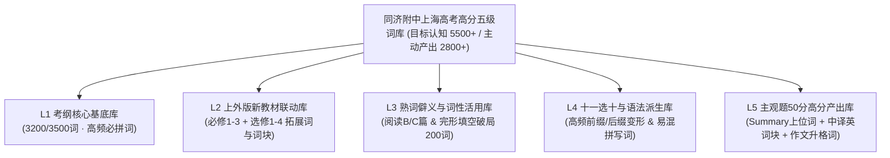

# 同济大学附属中学 — 上海高考英语高分分级词库构建方案与核心词表

> **文档编号**：`DOC-VOCAB-02`  
> **适用系统**：同济大学附属中学 · 办公室 AI 智能背词助教系统（SQLite 学情数据库核心底座）  
> **对标标准**：《上海市高中英语教学基本要求（词汇手册）》、上外版（沪教版）高中英语新教材、2015–2025 上海高考真题及徐汇/黄浦/浦东/杨浦四区一模二模语料库

---

## 一、 词库构建的四大核心原则

上海高考英语（笔试 115 分 + 听说 35 分）与全国卷存在本质差异：**外刊原味重、抽象思辨强、主观产出占比极高（概要 10 分 + 翻译 15 分 + 作文 25 分 = 50 分，占笔试 43.48%）**。若按传统背词软件“一词一义、全班一张表”的方式机械背诵，学生即便背完 3200 词也难以突破 115 分瓶颈。

本系统词库遵循以下**四大构建原则**：

### 1. “阅读认知词（Receptive）”与“主观产出词（Productive）”分类考核原则
- **认知型词汇（对标完形、阅读 B/C 篇、六选四，目标水位 5000~6000 词）**：重点考核学生**听音辨义、看词秒懂深层语境义与作者态度**，不强制要求默写冷僻长词拼写，避免无效耗费学生精力。
- **产出型词汇（对标语法填空、十一选十、概要写作、中译英、大作文，目标水位 2500~3000 词）**：强制执行**“零容错字母拼写 + 词性变形 + 固定介词搭配”**严苛考核，错一个字母在高考中即扣 0.5~1 分，必须在助教 Pad 上达到 100% 拼读/默写过关。

### 2. “一词多维：破除第一词义迷思”原则
- 针对上海高考最擅长的**“熟词僻义”**与**“词性活用（名词动用/形容词动用）”**，词库严禁只列初中第一词义（如 `address = 地址`、`harbor = 港口`），必须将**上海高考真题实际考查的高阶词义与搭配**置顶标红，直接作为出题题干。

### 3. “词根派生树（Morphological Family）”成组入库原则
- 上海高考命题规程明确规定：**考纲内词汇通过常见前缀（`un-`, `in-`, `im-`, `ir-`, `dis-`, `mis-`, `over-`, `under-`, `co-`）与后缀（`-able`, `-ive`, `-al`, `-ous`, `-ity`, `-ment`, `-ance`, `-ly`）生成的派生词，一律视为考纲内词汇，不计入 3% 超纲生词率**。
- 本词库将“母词 + 十一选十高频派生词 + 反义派生词”绑定入库，专门攻克语言运用部分。

### 4. “SQLite 学情库动态分层与四轮艾宾浩斯滚动”原则
- 词库与后台 **SQLite 学生学情数据库** 深度耦合：
  - **基础薄弱生（< 105 分）**：优先抽测 **L1 考纲核心基底词** + **L2 教材同步词**；
  - **中等稳健生（105 ~ 122 分）**：重点混排 **L3 熟词僻义词** + **L4 十一选十派生词**；
  - **高分冲刺生（123 ~ 138+ 分）**：主攻 **L5 概要写作上位概括词、大作文高阶升格词与外刊学术思辨词（AWL）**。

---

## 二、 五级校本词库架构方案（L1 ~ L5）

| 子库层级 | 子库名称 | 适用年级与分层对象 | 考核模式要求 | 对应上海高考题型（分值） |
| :--- | :--- | :--- | :--- | :--- |
| **L1** | **考纲 3200 核心必拼基底库** | 高一/高二全体、高三基础层 | 强制语音拼写 + 触屏默写 | 全卷基础托底 |
| **L2** | **上外版新教材同步拓展库** | 高一/高二同步滚动（4轮） | 语音拼读 + 词组搭配抽测 | 十一选十（10分）、完形（15分） |
| **L3** | **熟词僻义与词性活用专项库** | 高二进阶层、高三全体 | 语境释义辨析 + 语音报读 | 阅读理解 B/C 篇（16分）、完形（15分） |
| **L4** | **十一选十深度派生与易错拼写库** | 高二/高三全体 | 强制精确拼写 + 词性转换 | 语法填空（10分）、十一选十（10分） |
| **L5** | **主观题 50 分高阶产出升格库** | 高二培优层、高三冲刺 125+ 层 | 强制全拼默写 + 同义升格替换 | 概要（10分）+ 翻译（15分）+ 作文（25分） |

---

## 三、 具体核心词表清单（首批精选入库标准词条）

> **说明**：以下词条全部采用**标准 Unicode 国际音标（IPA）**标注，已按后台 SQLite 数据库 `words` 表字段规范整理，可直接导入系统作为首期示范与实测词库。

---

### 子库一（L1 & L4）：高考高频“高危易错拼写 & 十一选十深度派生”核心词表

这类词是上海学生在“语法填空、十一选十、概要写作”中因**漏字母、双写错误、后缀混淆**最容易无谓丢分的词汇：

| 序号 | 英文单词 | 标准国际音标 (IPA) | 词性 | 核心中文释义 | 高频搭配 / 派生族系 | 上海高考命题点拨与易错警示 |
| :--- | :--- | :--- | :--- | :--- | :--- | :--- |
| 1 | **phenomenon** | `/fəˈnɒmɪnən/` | n. | 现象；杰出的人或事物 | `natural phenomenon` 自然现象；复数：**`phenomena`** | Summary 高频上位词；学生极易把中间 `e` 拼成 `i` (`phenominon`)，或忽略复数 `phenomena` 后谓语用复数。 |
| 2 | **comprehension** | `/ˌkɒmprɪˈhenʃn/` | n. | 理解力；领悟；包含 | `beyond one's comprehension` 难以理解；adj. **`comprehensive`** 综合的、全面的 | 必须区分 `comprehensible`（可理解的）与 `comprehensive`（全面的，上海十一选十高频干扰对）。 |
| 3 | **sustainable** | `/səˈsteɪnəbl/` | adj. | 可持续的；站得住脚的 | `sustainable development`；n. **`sustainability`** | 人与自然主题必考词；注意动词原形 `sustain`（维持；遭受）在阅读中的用法。 |
| 4 | **imperceptible** | `/ˌɪmpəˈseptəbl/` | adj. | 极细微的；察觉不到的 | `an imperceptible change` 微乎其微的变化；adv. `imperceptibly` | 由考纲词 `perceive`（感知）经 `im-` + `-ible` 二次派生，上海卷十一选十经典压轴词。 |
| 5 | **irreplaceable** | `/ˌɪrɪˈpleɪsəbl/` | adj. | 不可替代的；独一无二的 | `play an irreplaceable role` 发挥不可替代的作用 | 注意拼写：**保留 `e`**（不能写成 `irreplacable`），大作文评价文化/教师价值满分用词。 |
| 6 | **invariably** | `/ɪnˈveəriəbli/` | adv. | 总是；毫无例外地；一贯地 | `invariably lead to` 总是导致… | 由 `vary` $\rightarrow$ `variable` $\rightarrow$ `invariable` $\rightarrow$ `invariably` 三级派生，十一选十副词槽位常客。 |
| 7 | **unjustified** | `/ʌnˈdʒʌstɪfaɪd/` | adj. | 无正当理由的；不合理的 | `unjustified criticism / fear` 无端的指责/恐惧 | 由 `justify`（证明…正当）派生，完形与十一选十高频态度评价词。 |
| 8 | **accommodate** | `/əˈkɒmədeɪt/` | v. | 容纳；为…提供住宿；顺应/迁就 | `accommodate to new circumstances` 适应新环境 | **高危拼写词**：注意是**双 c 双 m**（`cc` + `mm`），漏写一个字母即判全错。 |
| 9 | **embarrass** | `/ɪmˈbærəs/` | v. | 使尴尬；使窘迫；使为难 | `to one's embarrassment` 令某人尴尬的是 | **高危拼写词**：注意是**双 r 双 s**（`rr` + `ss`）。 |
| 10 | **occurrence** | `/əˈkʌrəns/` | n. | 发生的事情；出现；存在 | `an everyday occurrence` 司空见惯的事 | 由 `occur` 派生，注意**双 c 双 r** 且后缀为 `-ence`（非 `-ance`）。 |
| 11 | **conscientious** | `/ˌkɒnʃiˈenʃəs/` | adj. | 认真尽责的；一丝不苟的 | `a conscientious student / worker` 尽责的学生 | 极易与 `conscious`（有意识的 `/ˈkɒnʃəs/`）混淆，完形填空人物品质描写高频词。 |
| 12 | **indispensable** | `/ˌɪndɪˈspensəbl/` | adj. | 不可或缺的；绝对必要的 | `be indispensable to / for...` 对…不可或缺 | 注意后缀是 **`-able`** 而非 `-ible`，替换 `very important` 的首选词。 |
| 13 | **privilege** | `/ˈprɪvəlɪdʒ/` | n./v. | 特权；荣幸；给予特权 | `it is a privilege to do...`；`privileged` 有特权的 | **高危拼写**：中间是 `v-i-l-e-g-e`，切勿受发音影响多加字母 `d` 写成 `priviledge`。 |
| 14 | **perseverance** | `/ˌpɜːsɪˈvɪərəns/` | n. | 毅力；韧性；不屈不挠 | `show great perseverance`；v. `persevere (in)` | 记叙文（阅读 A 篇）与作文核心品质词，注意后缀为 `-ance`。 |
| 15 | **simultaneously** | `/ˌsɪmlˈteɪniəsli/` | adv. | 同时地；同步地 | `occur simultaneously` 同时发生 | 听力、概要写作与完形高频词，替换 `at the same time`。 |

---

### 子库二（L3）：上海高考必考“熟词僻义 & 词性活用”破局词表

这类词表面全是简单考纲词，但上海卷专考其**高阶动用义或抽象引申义**，是冲刺 125~135+ 必须通关的“防坑词库”：

| 序号 | 英文单词 | 标准国际音标 (IPA) | 考纲常规义（免考） | **上海高考核心考查僻义（必背）** | 真题语境搭配示例 | 对应题型 |
| :--- | :--- | :--- | :--- | :--- | :--- | :--- |
| 16 | **address** | `/əˈdres/` | n. 地址 | **v. 着手解决；处理；应对；向…发表演说** | `address the underlying problem` 解决根本问题 | 阅读B/C、概要、完形 |
| 17 | **harbor** | `/ˈhɑːbə(r)/` | n. 港口 | **v. 心怀（怨恨/疑虑/想法）；庇护，窝藏** | `harbor deep doubts about...` 对…心怀深切疑虑 | 阅读C篇、完形填空 |
| 18 | **compromise** | `/ˈkɒmprəmaɪz/` | n./v. 妥协，折中 | **v. 危及；损害；使陷入危险** | `compromise cognitive health / safety` 损害认知健康/危及安全 | 阅读B/C、十一选十 |
| 19 | **novel** | `/ˈnɒvl/` | n. （长篇）小说 | **adj. 新颖的；新奇的；前所未有的** | `a novel approach to battery recycling` 一种新颖的电池回收方法 | 阅读B/C（科技文必考） |
| 20 | **subject** | `/ˈsʌbdʒɪkt/` `/səbˈdʒekt/` | n. 科目；主题 | **adj. 易遭受…的 (`be subject to`)；n. 实验受试者；v. 使经历** | `The schedule is subject to change`；`200 healthy subjects` 200名受试者 | 阅读B/C（实验报告必考）、中译英 |
| 21 | **faculty** | `/ˈfæklti/` | n. 全体教员；院系 | **n. （人体的）官能，感官；心智能力，天赋** | `critical faculties / mental faculties` 批判性心智能力 | 阅读C篇、十一选十 |
| 22 | **pronounced** | `/prəˈnaʊnst/` | v. 发音（过去式） | **adj. 显著的；明显的；明确的** | `a pronounced shift in public attitude` 公众态度的显著转变 | 阅读B/C、完形填空 |
| 23 | **promise** | `/ˈprɒmɪs/` | n./v. 承诺，答应 | **v. 预示着；有望带来；n. 获得成功的迹象** | `The new therapy promises a cure` 新疗法有望带来治愈希望；`show great promise` | 阅读B/C、完形填空 |
| 24 | **weather** | `/ˈweðə(r)/` | n. 天气 | **v. 经受住，平安度过（危机/风暴/困难）** | `weather the economic storm / crisis` 经受住经济危机 | 完形填空、阅读A/C篇 |
| 25 | **fuel** | `/ˈfjuːəl/` | n. 燃料 | **v. 刺激；加剧；推动（情绪/趋势增长）** | `fuel anxiety among adolescents` 加剧青少年群体中的焦虑 | 概要写作、阅读B/C |
| 26 | **tailor** | `/ˈteɪlə(r)/` | n. 裁缝 | **v. 专门定制；使适应特定需求 (`tailor...to...`)** | `tailor teaching methods to individual needs` 因材施教 | 十一选十、大作文、概要 |
| 27 | **subscribe** | `/səbˈskraɪb/` | v. 订阅（报刊） | **v. 赞同，认可（观点/理论）(`subscribe to`)** | `subscribe to the view that...` 赞同…的观点 | 阅读C篇观点态度题 |
| 28 | **dismiss** | `/dɪsˈmɪs/` | v. 解散；解雇 | **v. 对…不予理会；摒弃（想法）；认为…不值得考虑** | `dismiss the warning as exaggerated` 认为警告夸大其词而不予理会 | 阅读C篇、完形填空 |
| 29 | **tap** | `/tæp/` | n. 水龙头；v. 轻拍 | **v. 开发，发掘，利用（潜力/资源/市场）** | `tap into one's full potential` 发掘某人的全部潜能 | 十一选十、中译英、作文 |
| 30 | **sound** | `/saʊnd/` | n. 声音；v. 听起来 | **adj. 明智的；合理的；可靠的；酣畅的** | `make a sound judgment` 做出明智判断；`sound sleep` 酣睡 | 完形填空、中译英 |
| 31 | **arrest** | `/əˈrest/` | v./n. 逮捕 | **v. 阻止，抑制（衰退/发展）；吸引（注意力）** | `arrest the decline of biodiversity` 遏制生物多样性衰退 | 阅读B/C篇 |
| 32 | **check** | `/tʃek/` | v./n. 检查；支票 | **v./n. 抑制，遏制，控制 (`keep...in check`)** | `hold/keep inflation in check` 控制住通货膨胀 | 完形填空、阅读C篇 |
| 33 | **credit** | `/ˈkredɪt/` | n. 信用；学分 | **v. 把…归功于 (`credit A to B`)；n. 赞扬，功劳** | `do credit to...` 为…争光；`be credited with...` 被认为有…之功 | 十一选十、中译英 |
| 34 | **allowance** | `/əˈlaʊəns/` | n. 零花钱；津贴 | **n. 体谅，考虑到 (`make allowance(s) for`)** | `make allowances for his lack of experience` 体谅他缺乏经验 | 完形填空、中译英 |
| 35 | **informed** | `/ɪnˈfɔːmd/` | v. 通知（过去式） | **adj. 见多识广的；有充分依据的；明智的** | `make an informed decision / choice` 做出明智/知情的决定 | 阅读B/C、大作文高频词 |

---

### 子库三（L5-A）：Summary 概要写作（10 分）与阅读 C 篇“学术思辨与上位概括词”

上海高考概要写作要求将 350 词外刊浓缩为 **≤ 60 词**，严禁照抄原句，必须掌握以下高浓缩度的学术词汇：

| 序号 | 英文单词 | 标准国际音标 (IPA) | 词性 | 核心中文释义 | 概要写作 / 阅读思辨高频用法 |
| :--- | :--- | :--- | :--- | :--- | :--- |
| 36 | **ambiguous** | `/æmˈbɪɡjuəs/` | adj. | 模棱两可的；含糊不清的 | `an ambiguous attitude / wording`；n. `ambiguity`（阅读态度题核心词） |
| 37 | **skeptical** | `/ˈskeptɪkl/` | adj. | 持怀疑态度的 | `remain skeptical about/of...`（阅读观点题高频选项词） |
| 38 | **paradox** | `/ˈpærədɒks/` | n. | 悖论；自相矛盾的现象 | `a striking paradox`；adj. `paradoxical`（外刊引入段最爱用的核心概念词） |
| 39 | **dilemma** | `/dɪˈlemə/` | n. | 进退两难的困境 | `face a moral / ethical dilemma` 面临道德两难困境 |
| 40 | **proliferation** | `/prəˌlɪfəˈreɪʃn/` | n. | 激增；扩散；大量涌现 | `the proliferation of digital devices` 数字设备的激增（浓缩原文长串数量增长描述） |
| 41 | **deterioration** | `/dɪˌtɪəriəˈreɪʃn/` | n. | 恶化；退化；衰退 | `cognitive / environmental deterioration` 认知退化 / 环境恶化（v. `deteriorate`） |
| 42 | **disparity** | `/dɪˈspærəti/` | n. | （尤指不公正的）悬殊差距，不等 | `bridge the regional disparity` 弥合地区差距 |
| 43 | **prevalent** | `/ˈprevələnt/` | adj. | 普遍存在的；盛行的 | `become increasingly prevalent among youth`；n. `prevalence` 盛行 |
| 44 | **catalyst** | `/ˈkætəlɪst/` | n. | 催化剂；促进因素；诱因 | `act as a catalyst for reform` 成为变革的催化剂 |
| 45 | **scrutiny** | `/ˈskruːtəni/` | n. | 仔细审查；严密监督 | `come under close public scrutiny` 受到公众严密审视 |
| 46 | **viable** | `/ˈvaɪəbl/` | adj. | 切实可行的；能独立发展的 | `a viable alternative / solution` 切实可行的替代方案（Summary 结尾对策段必用词） |
| 47 | **detrimental** | `/ˌdetrɪˈmentl/` | adj. | 有害的；不利的 | `be detrimental to adolescent mental health`（高阶替换 `harmful`） |
| 48 | **conducive** | `/kənˈdjuːsɪv/` | adj. | 有益于…的；有助于…的 | `be conducive to independent thinking`（注意后接介词 `to` + 名词/动名词） |
| 49 | **alleviate** | `/əˈliːvieɪt/` | v. | 减轻；缓解；缓和（痛苦/问题） | `alleviate academic burden / traffic congestion`（Summary 措施段核心动词） |
| 50 | **undermine** | `/ˌʌndəˈmaɪn/` | v. | 暗中破坏；逐渐削弱（根基/信心） | `undermine mutual trust / executive function` 削弱互信/执行功能 |

---

### 子库四（L5-B）：上海高考中译英（15 分）与大作文（25 分）“核心采分词块与高分升格库”

中译英按 **0.5 分槽位**判分，学生必须对以下高频句型词块形成肌肉记忆：

| 序号 | 核心词块 / 升格表达 | 音标 / 核心词发音 | 对应中文考法（出题提示面） | 高考采分结构与造句规范 |
| :--- | :--- | :--- | :--- | :--- |
| 51 | **take...for granted** | `/ˈɡrɑːntɪd/` | 认为…理所当然；想当然 | `take it for granted that + 从句`（注意形式宾语 `it` 漏写扣 1 分） |
| 52 | **be bound to do** | `/baʊnd/` | 注定会…；必定会… | `Hard work is bound to pay off in the long run.` |
| 53 | **at the expense of** | `/ɪkˈspens/` | 以牺牲…为代价 | `pursue economic growth at the expense of the environment` |
| 54 | **give way to** | `/weɪ/` | 让位于…；被…取代；向…妥协 | `Initial panic gradually gave way to calm reflection.` |
| 55 | **live up to** | `/lɪv/` | 不辜负；达到（期望/标准） | `live up to parents' expectations` 不辜负父母的期望 |
| 56 | **attribute A to B** | `/əˈtrɪbjuːt/` | 把 A 归因于 B / 认为 A 出自 B | 被动：`A be attributed to B`（同义转换：`owe A to B` / `ascribe A to B`） |
| 57 | **Not until... did...** | `/ʌnˈtɪl/` | 直到…才…（句首部分倒装） | `Not until he experienced failure did he realize the value of persistence.` |
| 58 | **Hardly... when...** **No sooner... than...** | `/ˈhɑːdli/` | 一…就…（主句过去完成时倒装） | `Hardly had the policy been announced when it sparked heated debate.` |
| 59 | **Nothing is more... than...** | `/mɔː(r)/` | 没有什么比…更…（否定词+比较级表最高级） | `Nothing is more rewarding than overcoming a challenge through teamwork.` |
| 60 | **It goes without saying that...** | `/ˈseɪɪŋ/` | 不言而喻…；毫无疑问… | 大作文与中译英通用高分起手式 |

---

## 四、 词库在《办公室背词助教系统》中的落地应用机制

1. **数据库预置**：
   - 系统初始化 SQLite 数据库时，默认将上述 **L1~L5 分级代表词条**完整写入 `words` 表，每个词条自带：
     - `english`（英文）、`phonetic`（标准 Unicode IPA 音标）、`pos`（词性）、`chinese`（高考精准考义）
     - `level_tag`（`L1_考纲基底` / `L2_教材联动` / `L3_熟词僻义` / `L4_十一选十派生` / `L5_高分产出`）
     - `collocation`（真题搭配）、`gaokao_tip`（命题陷阱与易错点拨）。
2. **千人千面智能匹配**：
   - 当**张晓明（学霸，达标率 93.5%）**刷脸登录 Pad 时，后台学情引擎自动重点抽取 **L3 熟词僻义（如 `harbor`, `compromise`, `faculty`）** 与 **L5 Summary 上位词（如 `proliferation`, `paradox`, `alleviate`）** 助其冲刺 135+；
   - 当**李佳琪（基础偏弱，达标率 72.0%）**刷脸登录 Pad 时，后台学情引擎自动优先抽取其历史挂科的 **L1/L4 高危拼写词（如 `phenomenon`, `accommodate`, `comprehension`）**，确保基础分颗粒归仓。
